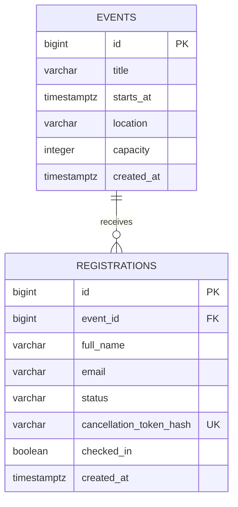

# EventOps

Event registration and attendance management built with **Java, Spring Boot, PostgreSQL, and JavaScript**. Organizers create events and track attendance; attendees register, join waitlists, and manage their registration with a private code.

[Live demo](https://eventops-mbekele1222.onrender.com/) · [75-second walkthrough](docs/eventops-demo.mp4) · [Test results](docs/QA_RESULTS_2026-10-30.md)


## What it does

- Creates events with a title, date, location, description, and capacity through an organizer login.
- Confirms registrations while seats are available and waitlists additional attendees.
- Rejects duplicate active registrations for the same event, including differences in email case or surrounding spaces.
- Cancels registrations with a private management code and promotes the next waitlisted attendee when a confirmed seat opens.
- Shows SQL summaries for confirmed, waitlisted, cancelled, and checked-in attendees.
- Lets organizers search and filter attendees and check in confirmed registrations.
- Preserves check-in across refreshes and prevents checked-in registrations from being cancelled.

The public demo supports attendee registration and private registration management. The captioned video combines live signup and cancellation captures with the organizer dashboard and persisted attendance captured during the October 30 QA run. Screenshots and demonstration records use synthetic attendees.

## Stack

| Layer | Technology |
|---|---|
| Backend | Java, Spring Boot 4.1, Spring MVC, Spring Data JPA, Hibernate |
| Database | PostgreSQL 17, SQL schema scripts, constraints, partial indexes |
| Security | Spring Security form login, organizer role, CSRF protection |
| Frontend | HTML, Bootstrap 5, JavaScript Fetch API |
| Testing | JUnit, Mockito, MockMvc, PostgreSQL repository tests, Python race scripts |
| Deployment | Docker, Render web service, Render PostgreSQL |

The Maven build targets Java 21. The provided Dockerfile uses Eclipse Temurin 25 for its build and runtime stages.

## How seat allocation works

Signup, cancellation, and check-in use database transactions. Each writer locks the event row with `SELECT ... FOR UPDATE` before reading or changing a registration. Competing requests for the same event therefore see the state committed by the preceding writer.

Registration compares the confirmed count with event capacity while holding that lock. Cancellation updates the registration and promotes the oldest active waiter in the same transaction. Waitlist order uses the registration ID, which is allocated during the locked signup transaction. Repeated cancellation does not promote another attendee, and repeated check-in preserves the same attendance record.

Capacity across multiple registrations is enforced by this transaction logic. SQL constraints separately enforce valid row values and relationships.

## Database design

`events` stores event details and capacity. `registrations` references its event and stores attendee details, status, attendance, and a hash of the private management code.



Database rules include:

- Positive event capacity and nonblank titles, locations, and attendee names.
- A foreign key that prevents registrations from referencing a missing event.
- Normalized email addresses and a partial unique index on `(event_id, email)` for `CONFIRMED` and `WAITLISTED` registrations.
- A status check restricting values to `CONFIRMED`, `WAITLISTED`, and `CANCELLED`.
- A check requiring checked-in registrations to remain confirmed.
- An index on `(event_id, status, id)` supporting event/status lookup and waitlist order.

Cancelled records remain in history. A cancelled email can register again with a new registration ID and private code, joining at the back of any existing waitlist.

The organizer summary query uses a `LEFT JOIN` and PostgreSQL filtered aggregates, so events with no registrations still appear with zero counts. The event detail endpoint reads counts and the attendee list in one repeatable-read transaction to keep them consistent.

## Run locally

Prerequisites: **JDK 21 or newer**, Git, and a running PostgreSQL 17 instance. Maven is supplied through the repository wrapper.

The commands below assume a PostgreSQL role matching your system username with local database access already configured.

```bash
git clone https://github.com/mbekele1222/eventops.git
cd eventops
createdb -h localhost eventops
psql -h localhost -d eventops -v ON_ERROR_STOP=1 -f sql/001_create_events.sql
psql -h localhost -d eventops -v ON_ERROR_STOP=1 -f sql/002_create_registrations.sql
```

Apply the SQL scripts once to a fresh database, in the order shown. Hibernate validates the existing schema at startup.

Configure the local connection. Change the username if your PostgreSQL role differs from your system username.

```bash
export SPRING_DATASOURCE_URL='jdbc:postgresql://localhost:5432/eventops'
export SPRING_DATASOURCE_USERNAME="$USER"
export SPRING_DATASOURCE_PASSWORD=''
```

Set the organizer password interactively. Run the following command by itself, enter a password of your choice, and press Enter:

```bash
read -r -s EVENTOPS_ORGANIZER_PASSWORD
```

Then start the application in that terminal:

```bash
export EVENTOPS_ORGANIZER_PASSWORD
./mvnw spring-boot:run
```

Open `http://localhost:8080`. Use username **organizer** and the password you just entered for organizer access. The dashboard is at `/dashboard.html`; event creation is at `/organizer.html`.

## Run the tests

With PostgreSQL running and the two schema scripts applied:

```bash
./mvnw test
```

The suite contains **29 tests** covering cancellation and promotion, check-in rules, organizer authorization, CSRF enforcement, SQL summaries, repository queries, and application startup. Repository fixtures run in transactions and roll back after each test.

| Test class | Tests |
|---|---:|
| `RegistrationCancellationTests` | 7 |
| `OrganizerCheckInTests` | 9 |
| `OrganizerSecurityTests` | 9 |
| `OrganizerRepositoryTests` | 3 |
| `EventopsApplicationTests` | 1 |

The optional scripts in `scripts/` exercise concurrent signup and cancellation against a running local application. They require the empty test events named in each script and the PostgreSQL executable configured there.

[The October 30 QA report](docs/QA_RESULTS_2026-10-30.md) records the completed Java suite, isolated HTTP checks, and live API and organizer browser checks. These are functional test results; they do not claim load benchmarks or independent human usability feedback.

## API

| Method | Endpoint | Access and purpose |
|---|---|---|
| GET | `/api/events` | Public event list |
| GET | `/api/events/{id}` | Public event details |
| POST | `/api/events` | Organizer event creation |
| GET | `/api/csrf` | CSRF token for form and API submissions |
| POST | `/api/events/{id}/registrations` | Public signup |
| POST | `/api/registrations/status` | Status lookup with a private code in the request body |
| POST | `/api/registrations/cancel` | Cancellation with a private code in the request body |
| GET | `/api/organizer/events` | Organizer event summaries |
| GET | `/api/organizer/events/{id}` | Organizer counts and attendee list |
| POST | `/api/organizer/events/{eventId}/registrations/{registrationId}/check-in` | Organizer check-in |

POST requests require a valid CSRF token. Organizer routes require the organizer role. Attendee details are excluded from public event responses, and private management codes and their hashes are excluded from organizer responses.

A registration receipt returns the private management code once. The database stores its SHA-256 hash. Attendees need to save the original code to manage their registration.

## Deployment

The `Dockerfile` builds an executable Spring Boot JAR and runs it as a non-root user. The production profile reads these environment variables:

| Variable | Value |
|---|---|
| `SPRING_PROFILES_ACTIVE` | `prod` |
| `EVENTOPS_DATABASE_URL` | PostgreSQL JDBC URL for the deployed database |
| `EVENTOPS_DATABASE_USERNAME` | Actual database role |
| `EVENTOPS_DATABASE_PASSWORD` | Database password |
| `EVENTOPS_ORGANIZER_PASSWORD` | Organizer login password |
| `PORT` | HTTP port supplied by the host |

Use the `jdbc:postgresql://HOST:5432/DATABASE?sslmode=require` URL format. Database credentials stay in their separate environment variables. Use `/api/events` as the health-check path.

Render's free service can display a loading page while waking after inactivity. Its free PostgreSQL database also has an expiration period; see [Render's current free-service documentation](https://render.com/docs/free) when evaluating demo availability.

## Current scope

The application uses one configured organizer account. It supports public guest registration with private management codes rather than attendee accounts. Status updates are retrieved through refresh/status lookup. Email notifications, QR scanning, and multiple organizer accounts are future work.
