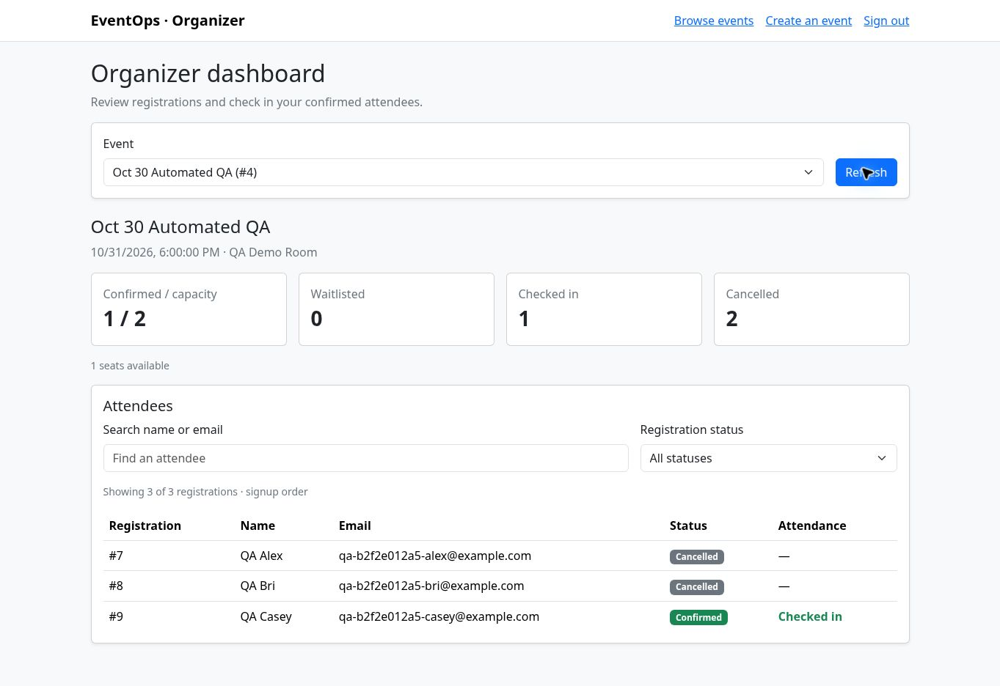

# EventOps QA results — October 30, 2026

Commit tested: `f94f773`.

## Results

All completed functional checks passed. The previously pending live organizer checks are now complete.

| Check group | Result | Environment |
|---|---|---|
| Existing Java suite | 29 passed, 0 failures, 0 errors, 0 skipped | Isolated test database |
| HTTP workflows | 31 passed | Isolated running app |
| Public API checks | 15 passed | Live Render deployment |
| Registration, promotion, and attendance flow | 13 passed | Live Render deployment |
| Organizer browser checks | 14 passed | Live desktop browser |

## Live flow verified

1. Signed-in organizer created the dedicated **Oct 30 Automated QA** event with capacity 2.
2. QA Alex and QA Bri were confirmed; QA Casey was waitlisted.
3. Search and the Confirmed, Waitlisted, and Cancelled filters displayed the expected attendees.
4. Cancelling QA Alex promoted QA Casey. Repeating cancellation did not release another seat.
5. Organizer checked in QA Casey using the live dashboard.
6. Attendance persisted after the dashboard Refresh button and a full browser page reload.
7. The live API independently confirmed check-in and rejected cancellation of the checked-in attendee.
8. Other synthetic attendees were cancelled after testing. The checked-in record was retained by the application rule.

## QA event state at the test checkpoint

| Attendee | Registration | Status | Checked in |
|---|---|---|---|
| QA Alex | #7 | CANCELLED | false |
| QA Bri | #8 | CANCELLED | false |
| QA Casey | #9 | CONFIRMED | true |

Totals: **1 confirmed / 2 capacity; 0 waitlisted; 1 checked in; 2 cancelled**.

## Findings

- No functional failures were observed in the completed checks.
- Minor wording issue: the dashboard displays **1 seats available** instead of **1 seat available**. This did not affect registration or attendance.
- The free hosting service initially displayed its wake-up screen; live checks completed after it became available.

## Scope

- The isolated workflow used Java 21 and embedded PostgreSQL 18 (PGlite). Live checks exercised the deployed application with its PostgreSQL 17 database.
- These results cover automated API checks and desktop browser interactions. No independent human usability feedback or mobile layout review is claimed.
- The synthetic registration from the earlier public smoke test (#6) was also cancelled. Cancellation history remains in the database as designed.
- Private management codes, CSRF tokens, credentials, and browser cookies are excluded from this report.

## Live organizer browser checks

| Check | Result |
|---|---|
| Live organizer sign-in | PASS |
| Event creation through the organizer page | PASS |
| Dashboard shows both seats filled | PASS |
| Waitlisted attendee has no check-in action | PASS |
| Attendee search matches names without case sensitivity | PASS |
| Waitlist filter shows only the waitlisted attendee | PASS |
| Confirmed filter shows the two confirmed attendees | PASS |
| Live dashboard reflects cancellation and waitlist promotion | PASS |
| Cancelled attendee has no check-in action | PASS |
| Cancelled filter shows only the cancelled attendee | PASS |
| Promoted attendee checks in through the live organizer UI | PASS |
| Check-in persists after dashboard Refresh | PASS |
| Check-in persists after a full browser page reload | PASS |
| Final live dashboard totals match cleaned-up test registrations | PASS |

## Live registration and attendance checks

| Check | Result |
|---|---|
| Dedicated live QA event has two seats | PASS |
| QA Alex receives CONFIRMED | PASS |
| QA Bri receives CONFIRMED | PASS |
| QA Casey receives WAITLISTED | PASS |
| Live duplicate prevention handles normalized email | PASS |
| Third attendee is waitlisted before cancellation | PASS |
| Confirmed attendee can cancel on the live deployment | PASS |
| Live cancellation promotes the oldest waiter | PASS |
| Repeated cancellation keeps the promotion stable | PASS |
| Organizer UI check-in persists in the live API | PASS |
| Live checked-in attendee cannot cancel | PASS |
| Rejected cancellation preserves live attendance and confirmation | PASS |
| Other confirmed attendee retains the seat during the test | PASS |

## Earlier live public checks

| Check | Result |
|---|---|
| Live public event list returns valid JSON | PASS |
| Public event list excludes attendee and private-code fields | PASS |
| Live organizer data requires sign-in | PASS |
| Live dashboard requires sign-in | PASS |
| Live signup rejects blank names | PASS |
| Live signup rejects invalid email addresses | PASS |
| Live signup rejects requests without CSRF protection | PASS |
| Live private-status lookup rejects malformed codes | PASS |
| Live private-status lookup rejects unknown codes | PASS |
| Live synthetic signup succeeds | PASS |
| Live duplicate-email check handles case and whitespace | PASS |
| Live private code retrieves the correct registration | PASS |
| Live private-status response excludes identities and private codes | PASS |
| Live synthetic registration can be cancelled | PASS |
| Live repeated cancellation is idempotent | PASS |

## Isolated HTTP checks

| Check | Result |
|---|---|
| Homepage loads with normal browser Accept headers | PASS |
| Anonymous visitor cannot access organizer data | PASS |
| Anonymous visitor cannot create events | PASS |
| Organizer sign-in succeeds | PASS |
| Organizer dashboard loads | PASS |
| Event validation rejects zero capacity | PASS |
| Empty event has zero counts and an empty roster | PASS |
| Alex receives CONFIRMED | PASS |
| Bri receives CONFIRMED | PASS |
| Casey receives WAITLISTED | PASS |
| Devin receives WAITLISTED | PASS |
| Duplicate email normalization is enforced | PASS |
| Blank registration name is rejected | PASS |
| Invalid registration email is rejected | PASS |
| Signup requires CSRF protection | PASS |
| Malformed private code is rejected | PASS |
| Unknown private code is rejected | PASS |
| Private status excludes identities and management codes | PASS |
| Cancelling a waiter does not release a seat | PASS |
| Cancellation promotes the oldest waiter | PASS |
| Repeated cancellation does not release another seat | PASS |
| Cancelled email can rejoin at the back of the queue | PASS |
| Waitlisted attendee cannot check in | PASS |
| Cancelled attendee cannot check in | PASS |
| Promoted attendee can check in and persists on fresh status lookup | PASS |
| Repeated check-in keeps one attendance record | PASS |
| Checked-in attendee cannot cancel | PASS |
| Registration cannot be checked into the wrong event | PASS |
| Organizer check-in requires CSRF protection | PASS |
| SQL totals agree with registration and attendance states | PASS |
| Logout removes organizer access | PASS |

## Wording fix

The polish update corrects the singular seat label to **1 seat available**. The functional test results above were collected against commit `f94f773` before that copy-only change.

## Walkthrough capture

A later live browser capture on the same event created Alex Demo (#10, confirmed) and Bri Demo (#11, waitlisted). Cancelling #10 promoted #11 to confirmed. Both registrations were cancelled after capture; the earlier checked-in QA attendee remained confirmed. The dashboard image above records the earlier QA checkpoint.
